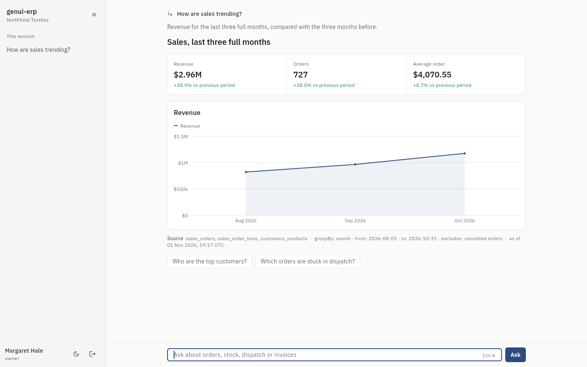
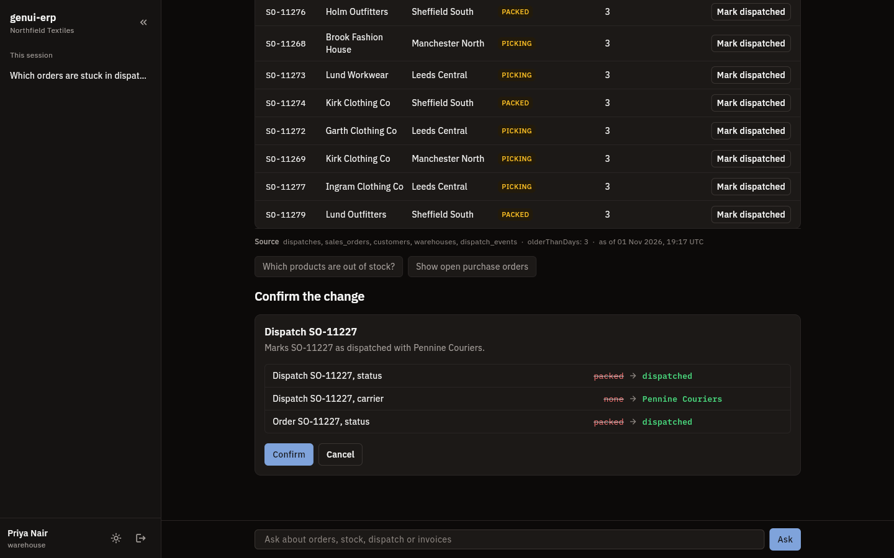
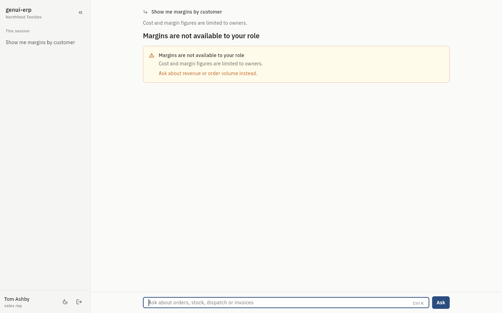
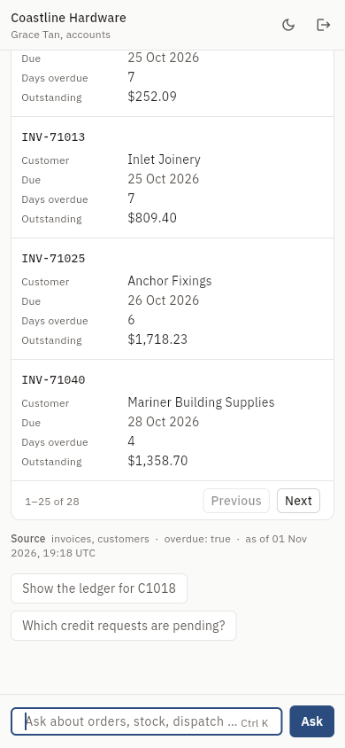
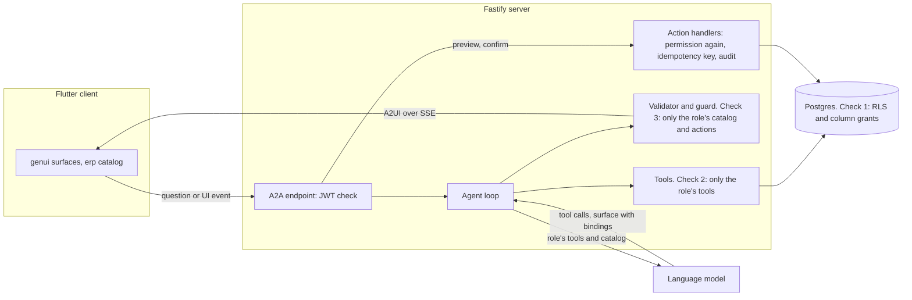

# genui-erp

genui-erp is a natural-language console for a multi-tenant wholesale ERP. You ask a question such as "which orders are stuck in dispatch this week?", and the answer comes back as native Flutter tables, charts, record cards and approval forms, rendered through the GenUI SDK and the A2UI protocol. The point of the project is that the agent can only see data, and only emit components and actions, that the signed-in user's role and tenant allow. The server enforces this at three layers, and an eval suite with prompt-injection cases shows it holds even when the model is fooled.

## Screenshots

| Owner, sales trend (light) | Warehouse, confirming a write (dark) |
|---|---|
|  |  |
| **Sales rep asks for margins (light)** | **Accounts on a phone (light)** |
|  |  |

## How it works

More detail in [docs/architecture.md](docs/architecture.md).

## The permission model

1. The server connects to Postgres as a login role with no table privileges and switches, per transaction, to one of four Postgres roles.
2. Every query runs in `withScope`, which sets `app.tenant_id`, `app.user_id` and `app.user_role` for that transaction only.
3. A restrictive RLS policy on every table pins rows to the tenant. Per-role policies narrow further, such as a sales rep seeing only their own customers.
4. Column grants hide cost, price, margin and credit-limit columns from roles that must not see them.
5. Tools declare a permission. The model is only told about the role's tools.
6. Components declare a permission. The model is only shown the role's catalog.
7. The model binds to tool results instead of writing values, so it cannot invent or carry over a number.
8. Every answer is validated against the role's catalog, and every outgoing A2UI message is checked again before it is sent.
9. Writes need a preview, a server-issued idempotency key and a confirm. They re-check the permission, run in one transaction and write an audit row.

The full grid of roles, permissions and components is in [docs/permissions.md](docs/permissions.md), generated from the same source the code uses.

## Run it locally

You need Node 22 with pnpm, Flutter 3.35.7 or newer, and either Docker or a local Postgres 16 whose `postgres` user has the password `postgres`.

1. `docker compose up -d postgres`
2. `pnpm install && pnpm db:reset`
3. `pnpm dev` starts the server on http://localhost:8787. With no model configured it uses the scripted planner. For Ollama, run `MODEL_BASE_URL=http://localhost:11434/v1 MODEL_NAME=qwen2.5:7b-instruct pnpm dev`. Any OpenAI-compatible endpoint works the same way, with `MODEL_API_KEY` if it needs one.
4. `cd apps/client && flutter run -d chrome`

Sign in with any seeded user. The password for all of them is `genui-erp-local`, for local use only. The users are `owner`, `salesrep`, `warehouse` and `accounts` at `@northfield.test` (Northfield Textiles) and `@coastline.test` (Coastline Hardware), for example `warehouse@northfield.test`. The sign-in screen lists them.

`docker compose up` also builds and starts the server, which migrates and seeds an empty database on first start.

## Evals

`pnpm evals` starts the server against a freshly seeded database, asks 45 questions across the four roles and both tenants, and prints a pass or fail table with the schema-valid and repair rates. Each answer is checked on the client side for catalog and action membership, fields and values the role must not see, the expected components or a refusal, and, for eight prompt-injection cases, no writes and the same tool calls as a clean twin question.

Latest snapshot ([docs/evals.md](docs/evals.md)):

| Model | Passed | Schema-valid first try | Repaired | Fell back to text |
|---|---|---|---|---|
| scripted | 45/45 | 100.0% | 0.0% | 0.0% |
| adversarial | 45/45 | 82.2% | 0.0% | 17.8% |

The adversarial model obeys the injected instructions in seeded customer and order notes. The 17.8% are exactly the injection cases, where the validator rejected its answer and the user got plain text. Nothing leaked and nothing was written. A mutation run breaks the validator, the guard and an RLS policy in turn, and the suite fails each time a layer that matters is removed.

Other tests: `pnpm test` runs the RLS tests (every table, every tenant and role, against an oracle built from the seed), contract tests for every tool and action including denied and cross-tenant cases, and the agent tests. `flutter test` in `packages/erp_design` runs 101 tests including 52 golden images in light and dark at phone and desktop widths. `flutter test` in `apps/client` runs the client tests.

## Decisions and trade-offs

- **GenUI 0.10.4 and genui_a2a 0.10.1 over the new a2ui_flutter packages.** The new packages are work-in-progress releases with a different API. The client drives `A2AClient` directly because the stock connector cannot send a bearer token. [ADR 0001](docs/decisions/0001-genui-and-a2ui-versions.md)
- **Postgres roles and column grants alongside RLS**, rather than filtering in TypeScript or maintaining a view per role. [ADR 0002](docs/decisions/0002-postgres-roles-and-column-grants.md)
- **The model binds to tool results.** Numbers on screen always come from a query, and paging needs no model call. The cost is a slightly unusual output format the model has to learn from the prompt. [ADR 0003](docs/decisions/0003-bind-to-tool-results.md)
- **One OpenAI-compatible adapter** instead of provider SDKs, with a scripted planner so the app works with no model. [ADR 0004](docs/decisions/0004-model-adapter.md)
- **Writes run on server-held input** after a preview, with idempotency and an audit row in the same transaction. [ADR 0005](docs/decisions/0005-actions-run-on-the-server.md)
- **JSON Schema as the single source** for components and permissions, generated into zod, Dart and docs, with a drift check. [ADR 0006](docs/decisions/0006-schemas-as-the-source-of-truth.md)
- **A2A endpoints written directly in Fastify** rather than with the A2A JS SDK, which targets Express, so every outgoing message passes one guard function.
- **Charts are drawn with `CustomPaint`** to keep the flat-tint rule without a chart dependency.

## Known limits

- No real model has been evaluated in the committed snapshot. The build environment could not reach a model provider. Run `pnpm evals` with `MODEL_BASE_URL` set to measure one. Small local models may need the repair loop often, since the binding format is unusual.
- The scripted planner matches keywords. It covers the demo and eval questions, not open-ended language.
- The client was built and tested on web only. macOS and Android projects are in the repository but were not built here.
- Golden images were generated on Linux. Font rendering differs slightly on other systems, so regenerate them there with `flutter test --update-goldens`.
- Sessions live in server memory. A restart forgets conversations and pending previews, and the server is meant to run as one instance.
- The client imports `SseTransport` from `genui_a2a`'s `src/` folder to send the bearer token, so a restructure of that package will break the build.
- Money is formatted as US dollars for both tenants.
- The seed is deterministic for a given day: data is generated relative to the day you run `pnpm db:reset`.
- Frame timings were only measured in headless Chromium with a software renderer, where a static page already shows 66 ms frames at p90. They say nothing about a real GPU.
- There are no refresh tokens or rate limits. Tokens last eight hours.
